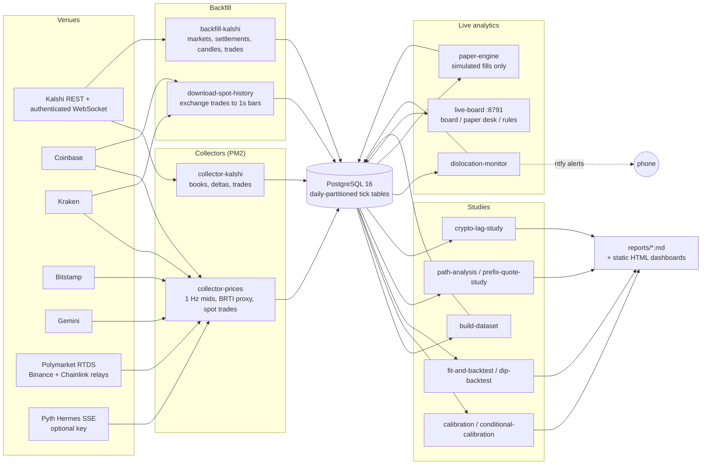

# Kalshi BTC short-duration market research

A data-collection and research system for [Kalshi](https://kalshi.com)'s 15-minute and hourly Bitcoin prediction markets. It captures live order books and index inputs, backfills everything the venues expose historically, stores it all in PostgreSQL, and runs statistical studies that ask one question from several angles: **do quoted prices match what actually happens?**

> **Research and paper trading only. Not financial advice.** Nothing in this repository places, modifies, or cancels real orders. There is no order-placement code. The "paper desk" simulates fills against captured market data.

## Why

Kalshi's `KXBTC15M` contracts ask "will BTC be higher at the end of this 15-minute window than at the start?" They settle on the CF Benchmarks Real-Time Index (BRTI): the 60-second average before close compared with the 60-second average before open. Short horizons, thin books at quiet hours, and a settlement index built from a handful of spot exchanges make these markets a natural place to look for mispricing. They also make it easy to fool yourself with patterns that don't survive realistic fills and fees.

The project treats "the market misprices X" as a hypothesis to falsify. Every candidate effect has to survive four steps: calibration against realized outcomes, clustering by market, a look-ahead-free fill-level backtest with Kalshi's exact fee schedule, and out-of-sample evaluation. A clean negative result counts as a finding.

## What the studies found (so far)

At **1-minute granularity**, every hypothesis tested came back efficient once it was restated as an executable trade:

| Study | Question | Result | Report |
| --- | --- | --- | --- |
| Calibration grid | Do contracts quoted at X% resolve YES X% of the time (by series, price bucket, time-to-expiry, hour)? | Commodity tail claim flat per market. The grid's two Bonferroni-flagged favorite-side cells vanish once clustered by market. One BTC cell (+4.7z clustered) went on to the dip backtest | [calibration](reports/calibration-2026-08-28.md), [clustered addendum](reports/calibration-addendum-clustered-2026-08-28.md) |
| Dip backtest | Does a +4.7z clustered calibration gap on cheap BTC contracts survive real fills? | No. At the first tradeable touch the market is priced correctly; the gap only existed against an *average* quote | [dip-backtest](reports/dip-backtest-2026-08-28.md), [lesson](lessons/average-quote-conditioning-artifact.md) |
| Conditional calibration | When the index proxy is above the strike but the book is below 50¢, who is right? | The book. In every credible z-bucket, realized outcomes track the quoted mid, not the index model | [conditional-calibration](reports/conditional-calibration-2026-08-29.md) |
| Fair-value model + backtest | Does a logistic fair-value model on normalized distance-to-strike beat the market out of sample? | No. Market mid has lower Brier score (0.1631 vs 0.1663); the threshold sweep is flat after fees | [backtest-v0](reports/backtest-v0-2026-08-29.md) |
| Path analysis + prefix-quote study | Does the market misprice "path states" (time spent above the strike, hover distance)? | No. Quoted ≈ realized in all 20 cells; trading an empirical lookup against the quote loses about 10% on risk out of sample | [path-analysis](reports/path-analysis-2026-08-28.md), [prefix-quote](reports/prefix-quote-study-2026-08-28.md) |

Effects that last only seconds can't be seen in 1-minute candles. The live order-book capture, the dislocation monitor, and the paper desk are there to measure that regime.

## Architecture



### Data sources

| Source | What is collected | Auth |
| --- | --- | --- |
| Kalshi WebSocket | Order book snapshots and deltas (venue `ts_ms`) and public trades; market discovery via REST as windows roll | API key (RSA-PSS signed handshake) |
| Kalshi REST | Market metadata, official settlement values, 1-minute candles, historical trades | None for market data |
| Coinbase, Kraken, Bitstamp, Gemini | Best bid/ask at 1 Hz. These four BRTI constituent exchanges feed a composite **BRTI proxy**. Coinbase spot trades are captured tick by tick | None |
| Coinbase / Kraken REST trade history | About 90 days of trades aggregated to 1-second bars for the backtests | None |
| Polymarket RTDS | Free Binance and Chainlink BTC relays, used as cross-references | None |
| Pyth Hermes | Crypto and commodity reference prices, used as change proxies | Bearer key (optional) |

**Free ground truth.** Each settled 15-minute market exposes its strike (official 60s BRTI average at open) and its settlement value (official average at close), and consecutive windows chain together. Backfilling settled markets therefore gives an official BRTI series at 15-minute cadence with no license. Outcomes and strikes in every study are exact, and only intra-window paths use the proxy. The data-quality report measures the proxy against those official values continuously. See [lessons/strike-chain-free-brti.md](lessons/strike-chain-free-brti.md).

### Schema overview

Defined in [`db/schema.sql`](db/schema.sql) and applied by `scripts/migrate.js`. The high-volume tables are partitioned by day, and the collectors create partitions ahead of time.

| Group | Tables |
| --- | --- |
| Kalshi market data | `kalshi_markets` (metadata, strikes, official `expiration_value`), `kalshi_book_snapshots` (1s books: best bid/ask, mid, spread, depth), `kalshi_book_deltas` (raw WS deltas), `kalshi_trades`, `kalshi_candles_1m` |
| Index and spot | `index_ticks` (exchange mids, `proxy_composite`, Polymarket and Pyth relays), `spot_ticks`, `spot_bars_1s` |
| Research datasets | `model_rows` (one row per market-minute: normalized distance-to-strike `z`, quotes, next-minute fills, outcome), `settlement_screens`, `window_path_stats`, `window_path_prefix` |
| Live analytics | `dislocation_events`, `paper_trades`, `paper_equity` |
| Operations | `collector_heartbeats`, `clock_sync`, `backfill_progress`, `spot_dl_state` |

### Repository layout

```
src/collectors/   live WebSocket collectors (Kalshi books/trades; exchange + relay price feeds)
src/backfill/     resumable historical backfills (Kalshi; Coinbase/Kraken spot history)
src/research/     studies, fair-value models (analytic + Monte Carlo), dislocation monitor, paper engine
src/report/       data-quality report and the live board (HTTP + SSE) with paper desk and rules pages
src/lib/          config, pg pool + partition management, Kalshi auth/REST helpers, logging
db/schema.sql     full schema
scripts/          migrate, dashboard snapshot builder, retention/archival, status pings
test/             math tests (fee table, normal CDF/quantiles, Wilson CI, calibration engine, effective-horizon variance)
reports/          generated study reports and two static dashboard snapshots
lessons/          one-page post-mortems of API quirks, data pitfalls and methodology mistakes
NOTES.md          verified API facts (Kalshi, BRTI, Polymarket, Pyth) with sources
```

## Running it

### Requirements

- Node.js 20+
- PostgreSQL 16
- [PM2](https://pm2.keymetrics.io/) for the long-running processes
- A Kalshi API key, needed **only** for the live order-book collector. Backfills and all historical studies use public endpoints.

### Setup

```bash
# 1. Database
createuser btc --pwprompt
createdb btc_research --owner btc

# 2. Dependencies
npm ci

# 3. Configuration
cp .env.example .env
#    edit .env: database credentials, and optionally Kalshi key ID + path to the private key PEM
#    (keep the PEM outside the repository; .gitignore blocks *.pem / *.key as a backstop)

# 4. Schema
npm run migrate
```

Every environment variable is listed with a one-line description in [`.env.example`](.env.example).

### Tests

```bash
npm test
```

Runs `test/math.test.js`: 29 checks. It needs no database or network. The fee function is checked against **all 21 rows** of Kalshi's published fee table, not a sample. A spot check once missed a floating-point ceiling bug; see [lessons/float-ceiling-fee-bug.md](lessons/float-ceiling-fee-bug.md).

### Historical research pipeline (no Kalshi key needed)

```bash
npm run backfill                 # Kalshi markets, settlements, 1-min candles, trades (hours; resumable)
#   node src/backfill/backfill-kalshi.js candles --skip-markets   # candles only, faster first pass
npm run spot-history             # Coinbase + Kraken trades -> 1s bars (hours; resumable)
npm run dataset                  # build model_rows + settlement_screens
npm run calibration              # calibration grid, reversal and hour-of-day panels
npm run calibration:conditional  # index-vs-quote disagreement panels
npm run backtest                 # fit fair-value model on train days, backtest on held-out days
node src/research/dip-backtest.js
node src/research/path-analysis.js
node src/research/prefix-quote-study.js
node src/research/crypto-lag-study.js
```

Each study writes a dated Markdown report to `reports/`.

### Live capture

```bash
mkdir -p logs
pm2 start ecosystem.config.js    # collector-kalshi, collector-prices, dislocation-monitor
pm2 start src/report/live-board.js --name live-board
pm2 start src/research/paper-engine.js --name paper-engine
pm2 save
npm run report -- 24             # data-quality report over the last 24h
```

The live board serves on `http://127.0.0.1:8791` by default (`LIVE_BOARD_HOST` / `LIVE_BOARD_PORT`). It has a live window view with rendered formulas, the paper desk at `/paper`, and strategy rules at `/rules`. Top-of-book changes are pushed from the collector through `pg_notify` and relayed to the browser over Server-Sent Events.

**Storage.** Full-depth capture writes several GB per day. `scripts/retention.sql` prunes aged partitions. `scripts/setup-archive.sh` and `scripts/archive-partitions.sql` move cold partitions to a PostgreSQL tablespace on an external drive instead, so nothing is lost. `scripts/retention-loop.sh` runs whichever applies every 6 hours.

**Alerts.** If `NTFY_TOPIC` is set, the dislocation monitor, `scripts/status-ping.sh`, and the retention loop push short notifications to [ntfy.sh](https://ntfy.sh).

## How the studies work

- **Calibration** (`calibration.js`): bucket every quoted moment by price and minutes-to-expiry, then compare the mean quote with the realized YES frequency. It reports gap, z-score, Wilson interval, and EV after the exact taker fee for both sides, and applies a Bonferroni-adjusted threshold across the grid. A clustered addendum re-runs the key panels with one unit per market, because candles in the same market share an outcome.
- **Conditional calibration** (`conditional-calibration.js`): restricts the sample to minutes where the BRTI proxy and the quoted book disagree, using normalized distance `z = x / (σ·√τ_eff)`. τ_eff accounts for the 60-second settlement average (τ − 2D/3, verified in the tests). A freshness split separates fresh index spikes from slow drift.
- **Fair-value model and backtest** (`fit-and-backtest.js`): logistic `P(up) = σ(a + b·z)` fit on train days only. Fills happen at the *next* minute's opening quote, never same-minute data, with exact per-order fee rounding. It compares Brier score with the market mid over identical rows, sweeps thresholds as a pattern rather than cherry-picking the best one, and includes a settlement-window push/reversal screen.
- **Monte Carlo fair value** (`mc-fair.js`): block bootstrap of recent empirical 1-second returns with an exact simulation of the 60-second settlement average, used alongside the analytic Φ(z).
- **Path analysis and prefix-quote study**: strike-anchored 1s paths per window, time-above and hover-distance statistics, and an out-of-sample test of an empirical "windows like this" lookup against live quotes.
- **Paper engine** (`paper-engine.js`): several simulated strategies on separate virtual books. Taker entries fill at the captured ask plus fee. Maker entries fill only when a captured trade prints strictly through the resting price. Risk limits and a kill file stop simulated entries. The engine never sends orders.

## Lessons

[`lessons/`](lessons/) holds 16 short post-mortems, one per file: what happened and why it mattered. Examples:

- A per-subscription (not per-market) WebSocket sequence counter that would have caused a snapshot-request storm
- Floating-point dust that left phantom order-book levels, which showed up as negative spreads
- A frozen exchange feed silently averaged into the index proxy, caught by decomposing residuals per venue
- Why comparing outcomes to an *average* quote creates edges that can't be traded
- Operational lessons: `caffeinate` doesn't keep a laptop awake on battery, and order-book depth can never be backfilled

## Guardrails

- **No live trading code.** The paper engine and dashboards only read market data and write simulated records.
- **No market manipulation.** The project measures and models settlement-index behavior. It never trades the underlying to influence a settlement.
- **Secrets stay out of the tree.** Credentials come from `.env` (ignored by git), and the Kalshi private key is referenced by path only.

## Disclaimer

This is a personal research project, shared to show the engineering and the methodology. It is not investment, trading, or financial advice, and nothing here recommends trading any contract. Prediction-market trading carries risk of loss. Kalshi, CF Benchmarks, Pyth, Polymarket and the exchanges named above are referenced only as data sources. This project is not affiliated with them. Check each venue's API terms before collecting data.
